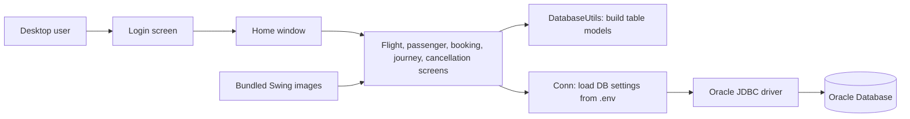

# Airline Management System

A Java Swing desktop application for managing airline passengers, flights, and reservations. It uses Oracle Database through JDBC.


## Features

- Sign in against the configured `LOGIN` table.
- View flight details and search available routes.
- Add passenger details.
- Book and look up reservations.
- Cancel reservations.

## Architecture



The UI is implemented with Java Swing. Screen classes handle user actions and issue parameterized JDBC queries through `Conn`; `DatabaseUtils` converts query results for table views. Images are packaged from `src/main/resources`.

## Requirements

- JDK 11 or later.
- Maven 3.6.3 or later.
- An Oracle database reachable from this machine, with the tables and columns listed below.

## Configure the database

Copy `.env.example` to `.env` and set values for your Oracle instance:

```dotenv
DB_URL=jdbc:oracle:thin:@localhost:1521/XEPDB1
DB_USER=your_database_user
DB_PASS=your_database_password
```

`DB_URL` is an Oracle JDBC URL. Adjust the host, port, and service name for your database. `.env` is ignored by Git and must not be committed.

The application expects these tables and columns (Oracle identifiers are case-insensitive unless quoted):

| Table | Columns used by the application |
|---|---|
| `LOGIN` | `username`, `password` |
| `FLIGHT` | `source`, `destination`, `f_name`, `f_code` (the flight-details screen displays all columns) |
| `PASSENGER` | `name`, `nationality`, `phone`, `address`, `aadhar`, `gender` |
| `RESERVATION` | `PNR`, `ticket`, `aadhar`, `name`, `nationality`, `flightname`, `flightcode`, `source`, `destination`, `ddate` |
| `CANCEL` | `pnr`, `name`, `cancellationno`, `flightcode`, `ddate` |

This repository does not include database schema or seed-data scripts. Create the tables and add flight/login records in Oracle before using the corresponding screens.

## Limitations

- Boarding pass generation is not implemented; the nonfunctional menu entry is not shown.
- Login compares the submitted password directly with the `LOGIN.password` value. Do not use this authentication setup in production without migrating to password hashing.

## Build and run

From the repository root:

```sh
mvn clean compile
mvn exec:java
```

The Maven exec plugin launches `com.sysairline.Login`. A graphical desktop session is required.

## Project layout

```text
src/main/java/com/sysairline/       Swing screens and JDBC helpers
src/main/resources/com/sysairline/  Application images
pom.xml                             Maven dependencies and launch configuration
```
